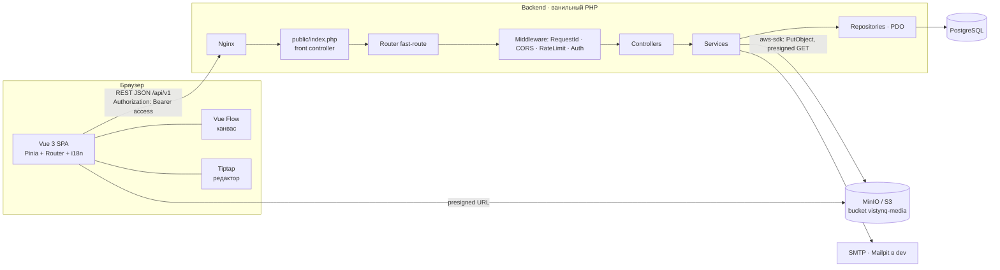
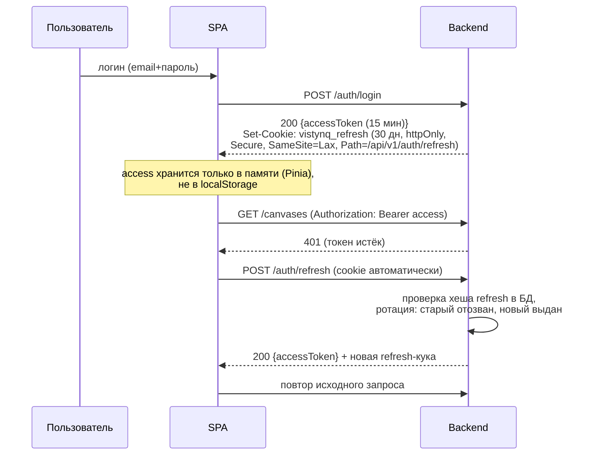
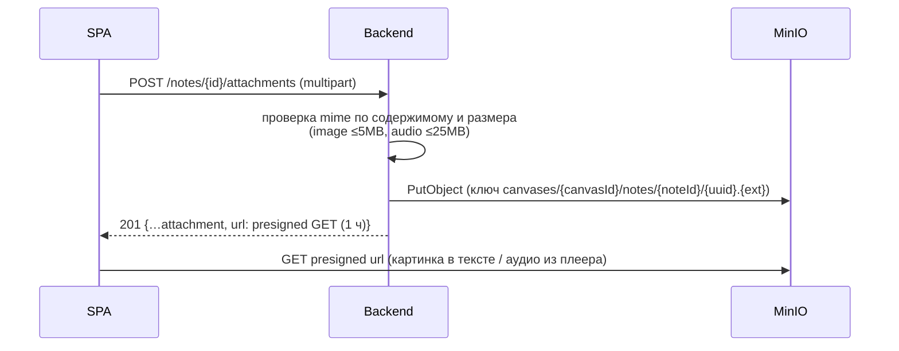
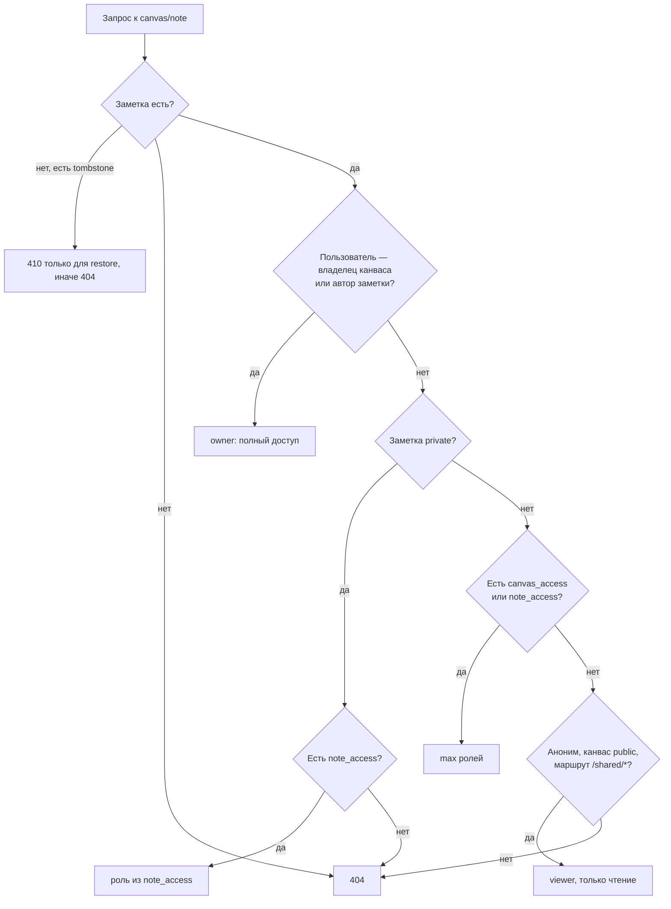

# Архитектура

## Общая схема



- Фронт и бэк раздельные: SPA отдаётся с `http://localhost:5173` (dev) / статики за nginx (prod), API живёт на `http://localhost:8000`.
- Бэкенд — stateless REST (кроме refresh-куки), вся бизнес-логика в Services, доступ к БД только через Repositories (PDO, подготовленные запросы).
- **Именование:** в JSON, TypeScript и коде — `camelCase`; в БД — `snake_case`. Преобразование выполняют только Repositories/Models (см. [data-model.md](data-model.md)).
- Разделение слоёв (R09): сервисы и контроллеры зависят от интерфейсов репозиториев (`*Interface`), а не от реализаций; все биндинги регистрируются в одном месте — `Support/ContainerFactory` (Kernel и интеграционные тесты используют одну конфигурацию). Контроллеры тонкие: только Request → сервис → Response. PDO живёт исключительно в `Repositories/*` и `Support/Database`; сервисы работают через `Database::transaction()`, `/healthz` — через `Database::ping()`.

## Структура monorepo

```
/
├── apps/
│   ├── backend/
│   │   ├── public/index.php        # front controller
│   │   ├── src/
│   │   │   ├── Kernel.php          # bootstrap: config, DI, error handler
│   │   │   ├── Config/             # загрузка env + типизированный конфиг
│   │   │   ├── Http/               # Router, Request, Response, Json
│   │   │   ├── Middleware/         # RequestId, CorsMiddleware, AuthMiddleware,
│   │   │   │                       # RefreshCookieMiddleware, RateLimit (auth)
│   │   │   ├── Controllers/        # Health, Auth, Profile, Canvas, Note, Tag, Link,
│   │   │   │                       # Access (доступ+инвайты), Attachment, Shared
│   │   │   ├── Services/           # AuthService, JwtService, RefreshTokenService, MailService,
│   │   │   │                       # AccessService (единая проверка прав),
│   │   │   │                       # CanvasService, NoteService, TagService, LinkService,
│   │   │   │                       # LinkParserService, InvitationService,
│   │   │   │                       # GraphService (сборка /graph), ArchiveService, SearchService,
│   │   │   │                       # MarkdownRenderer (санитизация),
│   │   │   │                       # Storage/ (StorageInterface, S3Adapter, LocalAdapter)
│   │   │   ├── Repositories/       # PDO-репозитории по таблицам + *Interface
│   │   │   │                       # (контракты для DI и фейков, R09)
│   │   │   ├── Models/             # DTO-сущности (snake_case ↔ camelCase)
│   │   │   └── Support/            # Container + ContainerFactory (DI),
│   │   │                           # Database (PDO, транзакции, ping), Logger,
│   │   │                           # Validator, исключения (ApiException и др.)
│   │   ├── migrations/             # 0001_name.sql … (applied через schema_migrations)
│   │   ├── bin/migrate · bin/seed · bin/serve
│   │   ├── storage/                # LocalAdapter (gitignored)
│   │   ├── composer.json
│   │   └── Dockerfile
│   └── frontend/
│       └── src/
│           ├── api/                # http-клиент (fetch) + авто-refresh, модули API
│           ├── stores/             # auth, canvases, canvas(активный), notes, ui
│           ├── router/             # guards: requires-auth / guest-only
│           ├── locales/            # ru.json, en.json
│           ├── views/              # Landing, Auth/*, Dashboard, CanvasView,
│           │                       # SharedCanvas, SharedNote, Profile, NotFound
│           ├── components/
│           │   ├── canvas/         # CanvasBoard, NoteNode, ContextMenu,
│           │   │                   # TagMenu, ImportanceFilter, ArchivePanel,
│           │   │                   # LinkLayer (edge-стилизация)
│           │   ├── note/           # NoteEditorModal, ManifestForm,
│           │   │                   # AttachmentList, AudioPlayer, DropZone
│           │   ├── editor/         # Tiptap-обвязка + расширение WikiLink
│           │   ├── share/          # AccessDialog, InviteForm
│           │   └── ui/             # Button, Modal, Toast, Dropdown… (свой CSS)
│           ├── composables/        # useGraph, useDropFiles, useDebounce,
│           │                       # useAccessGuard, useContextMenu
│           └── styles/             # дизайн-токены, base.css
├── docs/
├── docker-compose.yml
└── turbo.json · pnpm-workspace.yaml
```

## Ключевые потоки

### 1. Авторизация (без XSS-рисков)



- Refresh-токен в БД хранится как SHA-256-хеш; ротация на каждом refresh; reuse детектируется → вся семья токенов отзывается.
- Logout: отзыв refresh в БД + сброс куки.
- CORS: `Access-Control-Allow-Origin: <конкретный origin>`, `Access-Control-Allow-Credentials: true`, разрешены заголовки `Authorization`, `Content-Type`.

### 2. Регистрация, смена email и письма

`POST /auth/register` → пользователь с `email_verified_at = null` → письмо со ссылкой на клиентский роут `/verify-email?token=…`, который вызывает `POST /auth/verify-email` с `{token}` в теле (токен не попадает в URL бэкенда и серверные логи — в URL он только для роутинга SPA). **Войти до подтверждения нельзя**: `POST /auth/login` отвечает 403 `EMAIL_NOT_VERIFIED`, refresh-кука не выдаётся. Поэтому у всех защищённых эндпоинтов подразумевается подтверждённый email, отдельной проверки «verified» нет.

Смена email (`PATCH /profile`): адрес записывается в `users.pending_email`, письмо с токеном (`purpose = email_change`) уходит на **новый** адрес; `email` меняется после `POST /auth/verify-email`. Пока адрес не подтверждён, пользователь остаётся верифицированным по старому.

При подтверждении email (регистрация) `InvitationService` превращает все `pending`-инвайты на этот адрес в доступы.

Reset-пароля: `POST /auth/forgot-password` (всегда 202, без утечки существования email) → письмо со ссылкой на клиентский роут `/reset-password?token=…` → `POST /auth/reset-password` (отзывает все refresh-токены). SMTP: PHPMailer; в dev — Mailpit.

### 3. Загрузка файлов (drop → S3)



- Upload идёт **через бэкенд** (прокси), прямых presigned PUT не используем — проще валидация и права. Имя файла в ключ не попадает (только расширение), оригинальное имя хранится в БД.
- `.md/.txt` вложениями **не являются**: drop на канвас → `POST /canvases/{id}/notes/from-text` (multipart, содержимое файла → `bodyMd` новой заметки); drop в редактор → клиент читает файл и вставляет текст в курсор.
- Аватар: `POST /profile/avatar`, ключ `avatars/{userId}/{uuid}.{ext}`.
- Удаление заметки/канваса каскадом удаляет строки `attachments`; объекты в S3 удаляет `StorageService` после коммита.

### 4. Косвенные ссылки (LinkParserService)

При `PUT /notes/{id}/body`: бэк парсит markdown-исходник регулярным разборщиком `[[target|label]]`, резолвит `target` (id заметки канваса или точное совпадение заголовка внутри канваса), пересоздаёт строки `indirect_links` для заметки в транзакции (повторяющаяся цель — одна строка). Фронт при вводе `[[` показывает автодополнение по заметкам канваса и вставляет канонический `[[uuid|Заголовок]]`. Разрывы/переименования заголовков отображаются при следующем парсинге.

При purge заметки её входящие косвенные ссылки получают `deleted_target_id` и рисуются как «ссылка удалена» (см. data-model.md). Недоступные зрителю ссылки не рендерятся.

### 5. Проверка доступа (AccessService — единая точка)

Модель: владелец канваса = автор канваса; автор заметки = её владелец; остальные получают `viewer`/`editor` выдачей на канвас или на конкретную заметку. У канваса `access_level` = `private`/`public`, у заметки `visibility` = `public`/`private`.



- Роль на заметку = owner, если пользователь автор или владелец канваса; иначе `max(canvas_access, note_access)` для публичной заметки и только `note_access` для приватной.
- Редактирует заметку: автор, владелец канваса, editor канваса (если заметка `public`), editor этой заметки.
- Если ресурс пользователю вообще недоступен — **404** (не раскрываем существование); если виден, но прав не хватает — **403**.
- Публичная (`public`) сущность доступна анониму **только на чтение** через read-only маршруты `/shared/*`; на всех остальных маршрутах нужен Bearer.
- Приватность графа «ничего лишнего»: в выдаче канваса для зрителя отфильтровываются узлы и рёбра к недоступным заметкам; недоступный `[[wikilink]]` рендерится как обычный текст (без раскрытия факта существования).
- «Ссылка удалена»: стёртая навсегда цель показывается пометкой только авторизованным пользователям, которые видят заметку-источник; цель в soft-delete — только ≥editor канваса (с кнопкой «восстановить»).
- Выдача доступа (`InvitationService`): аккаунт с таким email есть → строка в `*_access` сразу, письмо-уведомление; нет → `pending`-инвайт и письмо со ссылкой на регистрацию. Права на выдачу — только у владельца/автора ресурса.

### 6. Персистентность канваса

Позиции/размер нод (`x, y, width`) хранятся на заметке; патч отправляется дебаунсом (≈500 мс) `PATCH /canvases/{id}/nodes/{noteId}` после окончания перетаскивания/ресайза. Загрузка канваса — один запрос `GET /canvases/{id}/graph` (узлы + рёбра + теги + права текущего пользователя). Зум бесконечный — ограничение только мин/max масштаба Vue Flow (например 0.1–8).

## Конфигурация (env бэкенда)

| Переменная | Назначение |
|---|---|
| `APP_ENV`, `APP_URL`, `FRONTEND_URL` | режим, адреса (CORS, ссылки в письмах) |
| `DB_HOST`, `DB_PORT`, `DB_NAME`, `DB_USER`, `DB_PASS` | PostgreSQL |
| `JWT_SECRET`, `ACCESS_TTL=900`, `REFRESH_TTL=2592000` | токены |
| `S3_ENDPOINT`, `S3_REGION`, `S3_BUCKET`, `S3_ACCESS_KEY`, `S3_SECRET_KEY`, `S3_USE_PATH_STYLE=true` | MinIO/S3 |
| `SMTP_HOST`, `SMTP_PORT`, `SMTP_USER`, `SMTP_PASS`, `MAIL_FROM` | почта |
| `COOKIE_DOMAIN` (опц.), `COOKIE_SECURE` | refresh-кука `vistynq_refresh` |

## Ошибки и логирование

Единый обработчик: `ApiException {httpStatus, code, message, details}` → JSON `{error: {...}}`; непокрытые исключения → 500 `INTERNAL` (в prod без стека). Логирование — error_log/stdout контейнера, одна строка с context json и `requestId`, без токенов и паролей. Валидация входных параметров — точечная в Controllers через `Support\Validator`, без «магии».

## Тестирование

Единая позиция (см. `ROADMAP.md`, этап 3): все три уровня — в v1.

- Backend: PHPUnit — unit (AccessService, JwtService, Validator, ErrorHandler, LinkParserService) + интеграционные тесты на переносной test-postgres БД (R21, R22).
- Frontend: Vitest на клиентской логике (R33); e2e — Playwright против полного стека (R35, CI).
- `vue-tsc` входит в `pnpm build` и CI.

### Запуск backend-тестов (R21)

Требования на хосте: PHP ≥ 8.2 с расширениями `pdo_pgsql` и `sodium`
(Arch/CachyOS: `sudo pacman -S php-pgsql php-sodium`, `.ini` — в `/etc/php/conf.d/`).

```bash
# 1. Изолированная тестовая БД (не трогает dev-данные, порт 5433)
docker compose up -d test-postgres

# 2. Схема тестовой БД
cd apps/backend
DB_HOST=127.0.0.1 DB_PORT=5433 DB_NAME=vistynq_test php bin/migrate

# 3. Тесты (process env перебивает phpunit.xml и .env)
DB_HOST=127.0.0.1 DB_PORT=5433 DB_NAME=vistynq_test vendor/bin/phpunit
# или: composer test | composer test:unit | composer test:integration
```

Без test-postgres интеграция упадёт на подключении; без `pdo_pgsql`/`sodium`
юнит-тесты идут, интеграция скипается с сообщением.

Интеграционный сценарий `tests/Integration/AuthFlowTest.php` покрывает
register → verify → login → refresh (ротация + reuse → 401) → logout → 401;
сценарии доступа (матрица прав, приватные заметки, tombstone), графа и ссылок идут на той же БД.
