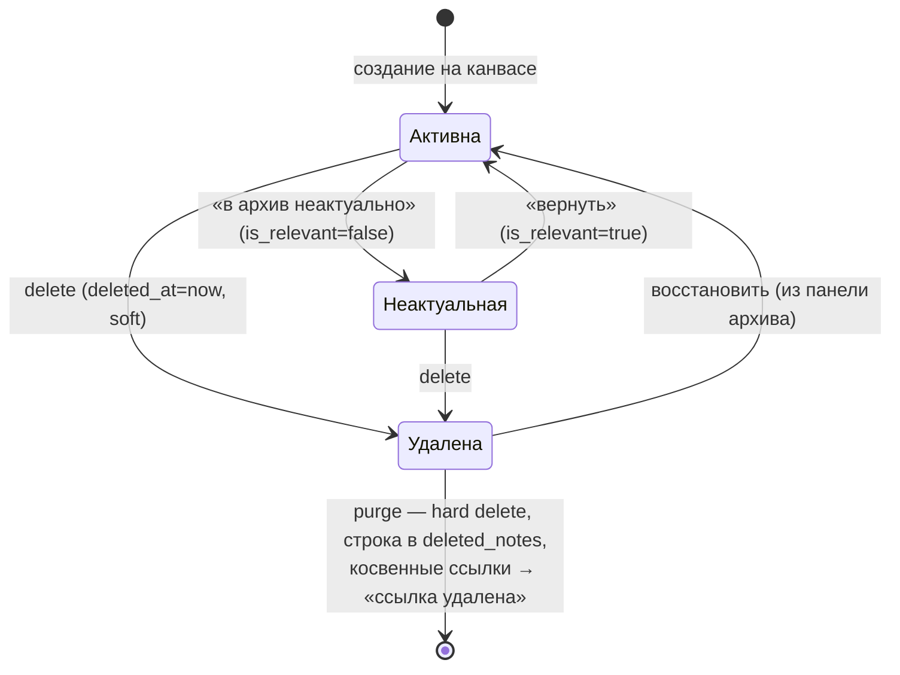
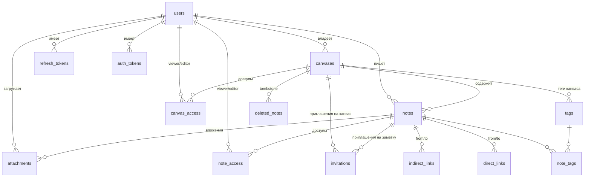

# Модель данных

PostgreSQL ≥ 15. Все id — `uuid` (`gen_random_uuid()`), время — `timestamptz` (по умолчанию `now()`). `citext` — для email и имён тегов (уникальность без учёта регистра).

**Именование.** В БД — `snake_case` (таблицы, колонки). В JSON API, TypeScript и остальном коде проекта — `camelCase`. Преобразование — только в слое Repositories/Models (DTO → `toArray()`), SQL и JSON-ключи друг в друга напрямую не просачиваются.

## Роли и права (модель данных)

- **Владелец канваса** (`canvases.owner_id`) и **автор заметки** (`notes.author_id`) — создатель ресурса. Он всегда имеет полные права на свой ресурс и не хранится в таблицах доступа. Владелец канваса имеет полные права и на все заметки своего канваса.
- Остальные получают доступ выдачей (`canvas_access` / `note_access`) с ролью `viewer` или `editor`. Роль `editor` одна и та же по смыслу; различается только область: editor канваса — весь канвас, editor заметки — только эта заметка.
- **Канвас**: `access_level` = `private` (только владелец и приглашённые) | `public` (любой по публичной ссылке, только чтение).
- **Заметка**: `visibility` = `public` | `private`.
  - `public` (по умолчанию) — заметка видна всем, кто имеет доступ к канвасу (при публичном канвасе — и анонимам, только чтение);
  - `private` — только автор, владелец канваса и те, кому выдан доступ именно на эту заметку.

## Таблицы

### users

| Поле | Тип | Описание |
|---|---|---|
| id | uuid PK | |
| email | citext UNIQUE NOT NULL | логин |
| pending_email | citext NULL | новый email, ожидающий подтверждения (partial UNIQUE WHERE NOT NULL) |
| password_hash | text NOT NULL | `password_hash(PASSWORD_ARGON2ID)` |
| display_name | text NOT NULL | имя для UI |
| avatar_attachment_id | uuid NULL FK → attachments ON DELETE SET NULL | аватар |
| email_verified_at | timestamptz NULL | null = не верифицирован (войти нельзя) |
| created_at / updated_at | timestamptz | |

Смена email: `pending_email` ← новый адрес, письмо уходит на него; `email` меняется только после подтверждения токена. Пользователь остаётся верифицированным по старому адресу, поэтому не может заблокировать себя опечаткой.

### refresh_tokens

| Поле | Тип | Описание |
|---|---|---|
| id | uuid PK | |
| user_id | uuid FK → users ON DELETE CASCADE | |
| token_hash | char(64) UNIQUE | SHA-256 от токена |
| family_id | uuid | группа ротации (reuse-detection) |
| expires_at | timestamptz | |
| created_at | timestamptz | |
| revoked_at | timestamptz NULL | отзыв |
| replaced_by | uuid NULL | id токена-преемника при ротации |

Индексы: `(user_id)`, `(family_id)`.

### auth_tokens

Одноразовые токены верификации email, подтверждения смены email и сброса пароля.

| Поле | Тип | Описание |
|---|---|---|
| id | uuid PK | |
| user_id | uuid FK → users CASCADE | |
| purpose | text CHECK IN ('email_verify','email_change','password_reset') | |
| token_hash | char(64) UNIQUE | |
| expires_at | timestamptz | TTL: 1 ч / 1 ч / 30 мин |
| used_at | timestamptz NULL | |

### canvases

| Поле | Тип | Описание |
|---|---|---|
| id | uuid PK | |
| owner_id | uuid FK → users CASCADE | владелец = автор |
| title | text NOT NULL CHECK (char_length ≤ 200) | |
| access_level | text NOT NULL CHECK IN ('private','public') DEFAULT 'private' | |
| public_slug | text UNIQUE NULL | slug публичной ссылки; NULL при `private` |
| created_at / updated_at | timestamptz | |

CHECK: `(access_level = 'public') = (public_slug IS NOT NULL)`. Индекс `(owner_id)`. При включении публичности генерируется новый slug, при выключении — обнуляется (старая ссылка перестаёт работать).

### notes

Заметка принадлежит ровно одному канвасу. Автор — создатель заметки (владелец канваса или editor канваса).

| Поле | Тип | Описание |
|---|---|---|
| id | uuid PK | |
| canvas_id | uuid FK → canvases CASCADE | |
| author_id | uuid FK → users | автор = владелец заметки |
| title | text NOT NULL CHECK (char_length ≤ 200) | |
| body_md | text NOT NULL DEFAULT '' | markdown-исходник с `[[...]]` |
| importance | smallint NOT NULL DEFAULT 3 CHECK BETWEEN 1 AND 5 | |
| is_relevant | boolean NOT NULL DEFAULT true | false = «неактуально», в архиве |
| visibility | text NOT NULL DEFAULT 'public' CHECK IN ('public','private') | |
| x, y | double precision NOT NULL DEFAULT 0 | позиция ноды |
| width | int NOT NULL DEFAULT 220 CHECK BETWEEN 120 AND 800 | ширина ноды; высота — у Vue Flow |
| created_at / updated_at | timestamptz | |
| deleted_at | timestamptz NULL | soft delete |

Индексы: `(canvas_id)`, `(canvas_id) WHERE deleted_at IS NULL`, `(author_id)`.

### tags (per-canvas)

| Поле | Тип |
|---|---|
| id | uuid PK |
| canvas_id | uuid FK → canvases CASCADE |
| name | citext NOT NULL CHECK (char_length ≤ 50) |
| color | text NOT NULL DEFAULT '#7c3aed' CHECK ~ '^#[0-9a-fA-F]{6}$' |

UNIQUE `(canvas_id, name)`. Rename/delete тега — UPDATE/DELETE одной строки, `note_tags` каскадирует.

### note_tags

| Поле | Тип |
|---|---|
| note_id | uuid FK → notes CASCADE |
| tag_id | uuid FK → tags CASCADE |

PK `(note_id, tag_id)`, индекс `(tag_id)`. Тег и заметка должны быть из одного канваса (проверяется сервисом).

### direct_links

Прямые (ручные) ссылки, направленные: from → to (родитель → дочерняя). Сплошная линия со стрелкой.

| Поле | Тип |
|---|---|
| id | uuid PK |
| from_note_id | uuid FK → notes CASCADE |
| to_note_id | uuid FK → notes CASCADE |
| created_by | uuid FK → users |
| created_at | timestamptz |

UNIQUE `(from_note_id, to_note_id)`, CHECK `from_note_id <> to_note_id`, индексы по обоим концам. Циклы разрешены. Обе заметки должны быть из одного канваса (проверяется сервисом). При purge заметки прямые ссылки на неё удаляются каскадом и без пометки.

### indirect_links

Кэшированный разбор `[[wikilinks]]` из `body_md`. Для заметки пересоздаётся целиком в транзакции при каждом сохранении тела.

| Поле | Тип | Описание |
|---|---|---|
| id | uuid PK | |
| from_note_id | uuid FK → notes CASCADE | заметка-источник |
| to_note_id | uuid NULL FK → notes ON DELETE SET NULL | цель, если она существует |
| raw_target | text NOT NULL | часть цели из `[[target\|label]]` (uuid или заголовок) |
| link_label | text NULL | подпись `label`, если указана |
| resolved | boolean NOT NULL | цель найдена в этом канвасе |
| deleted_target_id | uuid NULL | id стёртой (purge) цели; без FK |

UNIQUE `(from_note_id, raw_target)` (повторяющаяся цель — одна строка). Индексы `(from_note_id)`, `(to_note_id)`.

Состояния строки:
- `resolved = true`, `to_note_id` задан — живая ссылка;
- `resolved = false`, `deleted_target_id IS NULL` — цель не найдена (опечатка/переименование): ребра на графе нет, в тексте — обычный чип без связи;
- `resolved = false`, `deleted_target_id` задан — цель стёрта навсегда → ребро «ссылка удалена». При purge сервис в той же транзакции делает `UPDATE indirect_links SET to_note_id = NULL, deleted_target_id = :id, resolved = false WHERE to_note_id = :id`.

### deleted_notes (tombstone)

Создаётся при **полном** удалении (purge) заметки.

| Поле | Тип |
|---|---|
| note_id | uuid PK |
| canvas_id | uuid FK → canvases ON DELETE CASCADE |
| title_snapshot | text |
| deleted_by | uuid FK → users ON DELETE SET NULL |
| deleted_at | timestamptz |

Нужен, чтобы `POST /notes/{id}/restore` отвечал 410 (а не 404) на стёртую заметку и чтобы показывать заголовок в пометке «ссылка удалена». Удаляется вместе с канвасом.

### canvas_access / note_access (одинаковая структура)

| Поле | Тип |
|---|---|
| canvas_id / note_id | uuid FK CASCADE |
| user_id | uuid FK → users CASCADE |
| role | text CHECK IN ('viewer','editor') |
| granted_by | uuid FK → users ON DELETE SET NULL |
| created_at | timestamptz |

PK `(canvas_id, user_id)` / `(note_id, user_id)`. Владелец и автор в таблице **не** хранятся.

### invitations

Только для адресов, у которых **ещё нет аккаунта**. Если пользователь с таким email существует, доступ выдаётся сразу строкой в `*_access`, без инвайта.

| Поле | Тип | Описание |
|---|---|---|
| id | uuid PK | |
| canvas_id | uuid NULL FK → canvases CASCADE | ровно одно из `canvas_id` / `note_id` |
| note_id | uuid NULL FK → notes CASCADE | |
| email | citext NOT NULL | |
| role | text CHECK IN ('viewer','editor') | |
| status | text CHECK IN ('pending','accepted','revoked') DEFAULT 'pending' | |
| invited_by | uuid FK → users ON DELETE SET NULL | |
| created_at / resolved_at | timestamptz | |

CHECK: `(canvas_id IS NOT NULL) <> (note_id IS NOT NULL)`. UNIQUE `(canvas_id, email)` и `(note_id, email)` среди `pending`. Когда человек регистрируется и **подтверждает email**, все его `pending`-инвайты становятся `accepted`, и создаются строки `*_access`.

### attachments

| Поле | Тип | Описание |
|---|---|---|
| id | uuid PK | |
| uploader_id | uuid FK → users | |
| note_id | uuid NULL FK → notes ON DELETE CASCADE | `null` только для аватара |
| kind | text CHECK IN ('image','audio','avatar') | |
| s3_key | text UNIQUE | заметки: `canvases/{canvasId}/notes/{noteId}/{uuid}.{ext}`; аватар: `avatars/{userId}/{uuid}.{ext}` |
| filename | text | оригинальное имя (только для отображения, в ключ не попадает) |
| mime | text | определяется по содержимому |
| size_bytes | bigint | лимиты: image 5 МБ, audio 25 МБ |
| width / height | int NULL | только для картинок |
| created_at | timestamptz | |

Строки удаляются каскадом вместе с заметкой/канвасом; объекты в S3 удаляет `StorageService` после коммита (ключи собираются до удаления). Если удаление в S3 упало — ошибка логируется, объект остаётся «сиротой» (фоновая чистка — вне v1). Текстовые файлы `.md/.txt` как вложения не хранятся: их содержимое превращается в `body_md` (импорт или вставка в редактор).

### schema_migrations

`version text PK, applied_at timestamptz`.

## Жизненный цикл заметки

- «Неактуальная»: скрыта с канваса (видна с фильтром «показывать неактуальные»), остаётся доступной по ссылкам.
- «Удалена» (soft): нода скрыта, заметка в секции «Удалённые» панели архива. Ссылки на неё видят пользователи с правом ≥editor (с пометкой и кнопкой «восстановить»); viewer и аноним — не видят.
- «Purge»: физическое удаление строки `notes`, прямые ссылки удаляются, косвенные получают `deleted_target_id` (см. `indirect_links`), создаётся tombstone. Пометку «ссылка удалена» видят только авторизованные пользователи с доступом к заметке-источнику; аноним и посторонние — ничего.
- Удаление канваса: hard delete с каскадом всех заметок, ссылок, тегов, доступов, инвайтов и tombstone'ов (подтверждение в UI).

## ER-диаграмма

